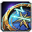

# Better Tracking

A WoW Forever addon that tracks herbs and ore at once and pings when a new node, rare or treasure shows up on your minimap. It swaps Find Herbs and Find Minerals for you as you move.

## Features

- Swaps Find Herbs and Find Minerals while you move, so your minimap shows both.
- Pings once for each new node and folds a cluster into one ping.
- Pings for rares and treasures on the minimap.
- Alerts with a sound, a flash of the minimap edge, or both.
- Stays quiet on flight paths, in combat and while dead.
- Can also ping at spots GatherMate2 remembers.
- A minimap button shows what you track and why the swap waits.

## Usage

1. Turn on Find Herbs or Find Minerals.
2. Hover a tracked blip near the edge of the minimap once. Chat says "Ready. Minimap alerts are on." You only do this once.
3. With Herbalism and Mining, middle-click the minimap button or type `/tra swap` to start swapping. Each swap costs a global cooldown.
4. Ride through a gathering area. Each new node pings once.
5. Right-click the minimap button to pause alerts. Left-click it or type `/tra` for the settings.

Commands:

- `/tra status` says whether alerts are on and why the swap waits.
- `/tra test` plays the alert.
- `/tra minimap` hides or shows the minimap button.

The swap waits in combat, in towns and instances, and while you stand still.
